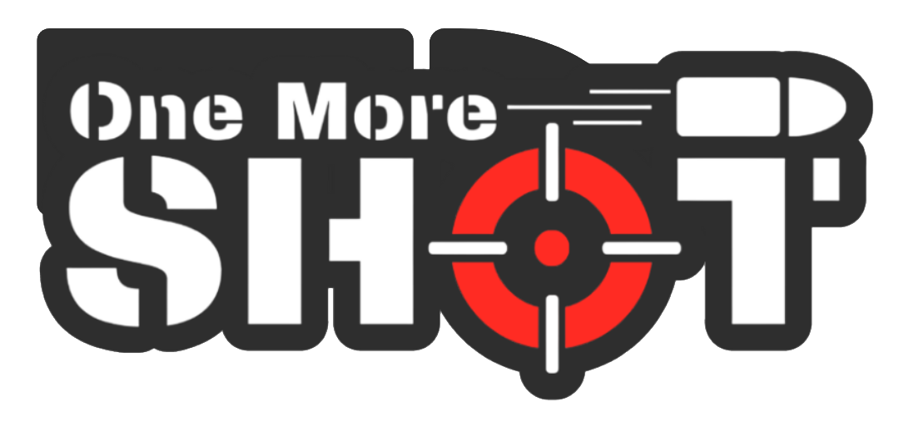
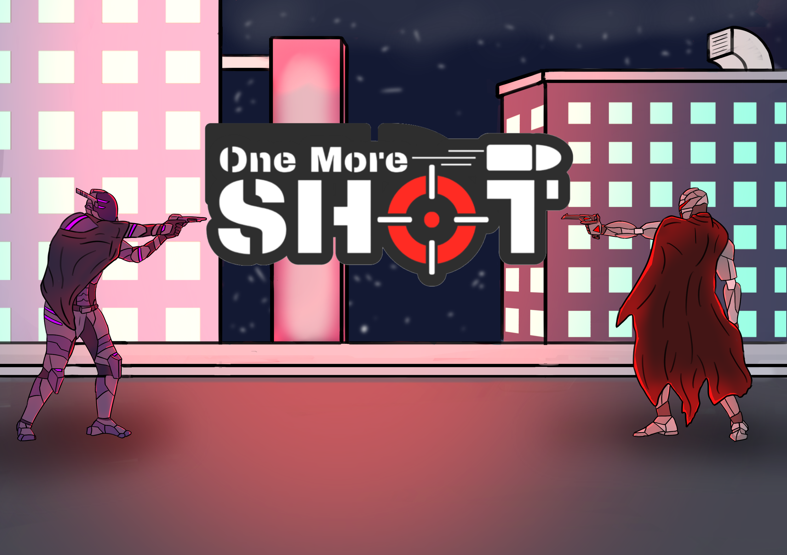
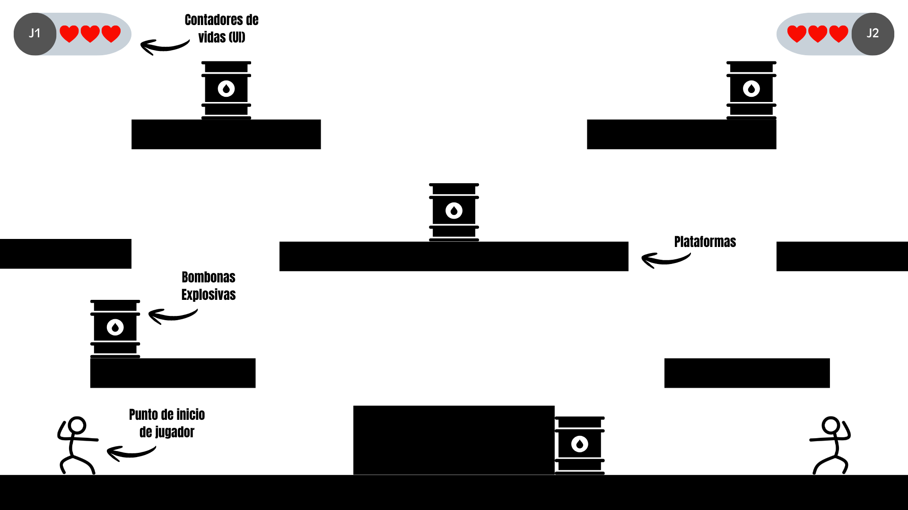
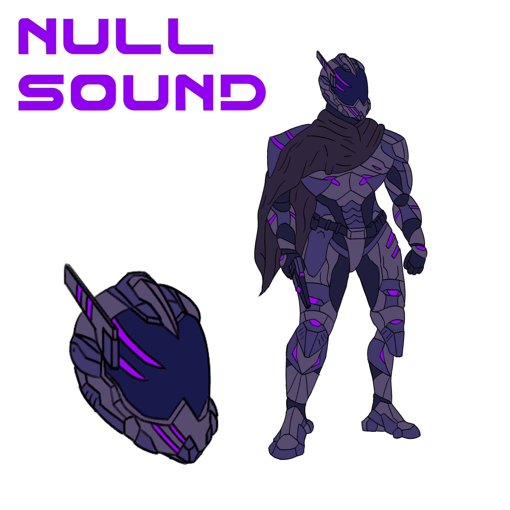
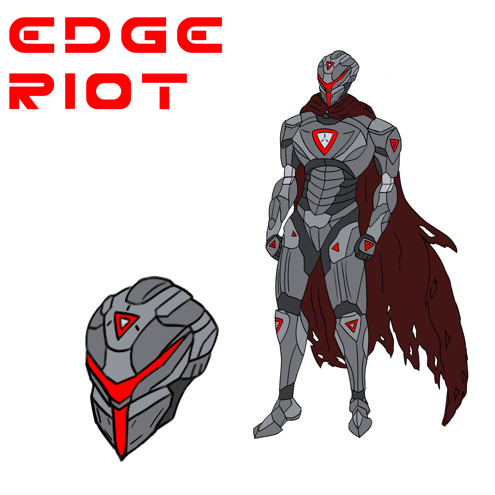
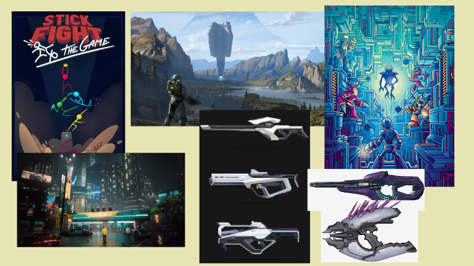
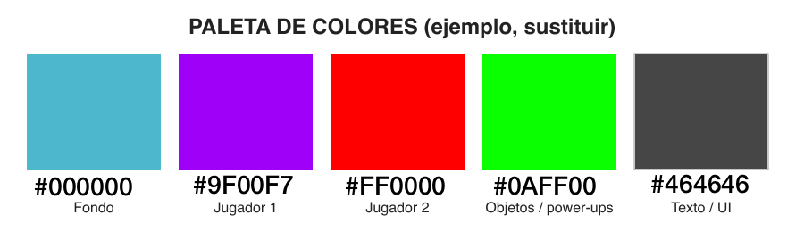
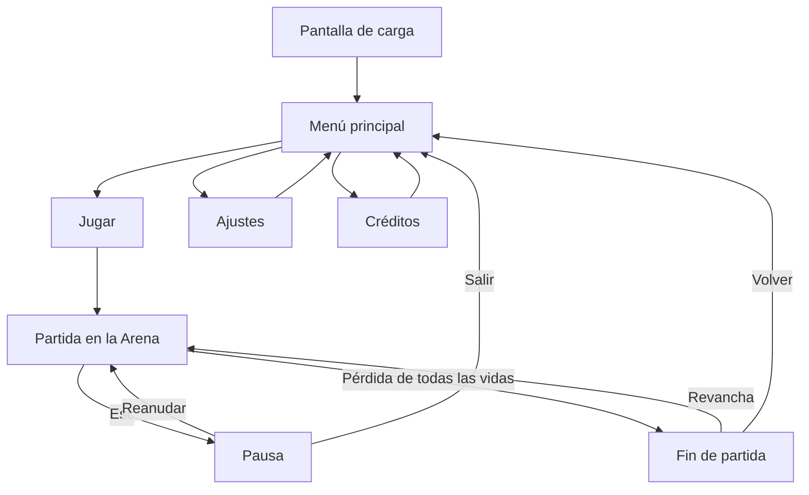

# JuegosEnRed-GrupoC
Integrantes del Grupo C: Hugo Rivera, Jesús Mañas y Alejandro Del Campo

  

# One More Shot

**Juegos en Red · Grado en Diseño y Desarrollo de Videojuegos · URJC · Curso 2026/27** 
**Grupo C**

## Descripción de la temática

One More Shot es un shooter en PixelArt 2D para dos jugadores en red. Ambientado en un mundo futurista, los jugadores deben luchar entre ellos usando potenciadores y habilidades para poder ganar la partida.

## Equipo de desarrollo

| Nombre y apellidos | Correo URJC | GitHub |
| Alejandro Del Campo | a.delcampom.2024@alumnos.urjc.es | `@alejandrodcm04-27` |
| Hugo Rivera | h.rivera.2024@alumnos.urjc.es | `@Forni8` |
| Jesús Mañas | j.manas.2024@alumnos.urjc.es | `@whitelyon21` |

**Repositorio:** `https://github.com/alejandrodcm04-27/JuegosEnRed-GrupoC`

**Licencia:** [Apache 2.0](LICENSE)

---

## 1. Introducción

### 1.1. Concepto del juego

One More Shot es un juego de acción arcade multijugador en 2D (PvP) en el que cada jugador es un personaje pixelart con un arma de fuego. La idea principal son combates rápidos y directos en un escenario cerrado (se ve completo en pantalla), donde los jugadores cuentan con tres vidas y un arsenal de potenciadores (power-ups) y elementos interactivos para eliminar a su rival.

### 1.2. Propuesta de valor

¿Qué hace diferente a One More Shot? El juego apuesta por controles simples combinados con caos y combate frenético. 

- **Interactividad:** Uso del entorno para atacar, como disparar a garrafas de gasolina que provocan explosiones de área.
- **Armamento dinámico:** Sistema de potenciadores aleatorios que alteran el estado del combate.
- **Riesgo y recompensa:** Las explosiones de distintos elementos y ciertos potenciadores pueden dañar tanto al enemigo como al jugador que los usa.

*Figura 1. Imagen promocional de One More Shot.*

---

## 2. Especificaciones básicas

| Aspecto | Descripción |
| **Título** | One More Shot |
| **Género** | Arena Shooter / Acción Arcade PvP |
| **Número de jugadores** | 2 (en red/local, tiempo real) |
| **Público objetivo** | Jugadores casuales de 12 a 30 años |
| **Clasificación PEGI** | PEGI 12 (Violencia no realista) |
| **Plataforma** | Navegador web (PC) |
| **Duración de una partida** | 2-3 minutos |
| **Representación** | 2D |
| **Licencia** | Apache 2.0 |

---

## 3. Jugabilidad

### 3.1. Objetivo del juego

El objetivo de cada jugador es eliminar al oponente utilizando armas de fuego, elementos del entorno y ayudarse de potenciadores. Cada jugador comienza con un contador de 3 vidas. La partida termina cuando uno de los dos pierde todas sus vidas. Gana el jugador que quede en pie.

### 3.2. Controles

| Acción | Jugador 1 | Jugador 2 |
| Moverse a la izquierda | `A` | `←` |
| Moverse a la derecha | `D` | `→` |
| Saltar | `W` | `↑` |
| Bajar de plataforma | `S` | `↓` |
| Apuntar | `W``A``S``D` | `↑``←``↓``→` |
| Poner Mina | `Q` | `-` |
| Activar Mina (solo tras ponerla) | `Q` | `-` |
| Disparar | Espacio | Enter |
| Pausa | `Esc` | `Esc` |

### 3.3. Mecánicas

#### 3.3.1. Mecánicas principales

- **Movimiento y Plataformas:** Los personajes pueden moverse lateralmente y saltar para navegar por el nivel y sus distintas alturas del escenario cerrado.
- **Disparo direccional:** Los jugadores apuntan y disparan en la misma direccion hacia la que se están moviendo, utilizando las teclas de dirección (`W``A``S``D` para el Jugador 1 y las flechas para el Jugador 2).
- **Interacción con el entorno:** Disparar a elementos explosivos del mapa (como barriles o garrafas de gasolina) activa una onda expansiva que causa daño en área. El daño es neutral y afecta tanto a enemigos como al propio jugador si está dentro del radio.

#### 3.3.2. Objetos y potenciadores

| Objeto | Efecto | Duración | Aparición |
| **Minas** | Crea una explosión de radio pequeño. La puede activar el jugador que la pone o por contacto. | Indefinida | 3 por jugador por partida |
| **Impulso de Velocidad** | Aumenta significativamente la velocidad de movimiento del personaje. | 8 s | Aleatoria |
| **Muerte instantanea** | Las balas matan de un solo impacto | 1 disparo | Aleatoria |
| **Fuego Rápido** | Disminuye el tiempo  entre disparos. | 5 s | Aleatoria |
| **Chaleco AntiBalas** | Te vuelves immune al daño de los disparos (pero no explosivos). | 5 s | Aleatoria |
| **Lanzacohetes** | Disparas proyectiles explosivos. | 2 disparos | Aleatoria |

#### 3.3.3. Sistema de puntuación y vidas

Cada jugador posee **3 vidas** representadas en el HUD. Un impacto directo con daño letal resta una vida (salvo uso de potenciadores varios). La condición de victoria es ser el último superviviente.

### 3.4. Físicas y dificultad

- **Gravedad y salto:** Movimiento rapido y responsivo. Con el salto se puede subir a los niveles superiores.
- **Colisiones de proyectiles:** Las balas colisionan y se destruyen al impactar con paredes, plataformas o jugadores.
- **Ondas expansivas:** Sistema de físicas para las garrafas de gasolina. Empujan a los personajes y restan daño si un jugador se encuentra dentro del radio de explosion.
- **Plataformas y plataformas móviles:** Las plataformas se pueden atravesar apretando el boton de movimiento hacia abajo y algunas de ellas estaran dotadas de movimiento.

### 3.5. Escenario

El escenario representa un entorno cerrado tipo "arena", visible en su totalidad sin movimiento de cámara. Se compone de plataformas ubicadas a diferentes alturas para fomentar el movimiento vertical.

*Figura 2. Mapa del escenario con zonas de aparición, plataformas y obstáculos.*

---

## 4. Narrativa

### 4.1. Historia

Es el año 2525, a la humanidad de unas pocas décadas atrás jamás se le habría ocurrido que en tan poco tiempo se habrían expandido ni fundado grandes ciudades por las estrellas.
Los avances tecnológicos habían permitido a la humanidad no solo viajar a otros planetas con facilidad, sino también crear atmósferas y suministros adaptados a las capacidades de cada planeta, pudiendo así asentarse y formar enormes ciudades de colores neón en lugares que antes solo se podían observar por un telescopio. La Tierra ya no era el centro del universo, solo un punto más, una nueva era dorada había comenzado.

Como era de esperar, no todo eran sueños hechos realidad en las ya no tan nuevas colonias espaciales. Pobreza, delincuencia, corrupción y violencia eran el pan de cada día para los más desafortunados. A algunos de esos desafortunados, se les otorgó la posibilidad de tratar de arreglar las cosas, unirse a un proyecto de supersoldados denominado “Programa Spartan” .
Mientras tanto, otros veían un camino que seguir para ganarse la vida: ser un Cazarecompensas.

Nuestros protagonistas, cada uno de un bando pero no tan distintos entre sí, habían recibido la misma misión y mismo encargo, detenerse el uno al otro.

### 4.2. Personajes

Aunque mecánicamente el juego es simétrico para mantener el equilibrio competitivo, a nivel narrativo cada avatar representa a un competidor distinto.

#### Jugador 1 

*Figura X. Boceto del personaje Jugador 1.*

- **Edad / origen:** 24 / Meridia
- **Personalidad:** Seria, decidida y tranquila.
- **Motivación:**  Acabar con la delincuencia para crear un futuro justo y seguro.
- **Habilidad especial:** (A nivel narrativo) “Ultimate Agility”: puede moverse por cualquier terreno o superficie sin importar que tan alta o empinada esté.
- **Trasfondo:**  Uno de los huérfanos y de las muchas víctimas afectadas tras la destrucción de su planeta natal, Meridia, que se unió al Programa Spartan. Samuel Sampers, tenía algo que lo hacía diferente a muchos, su determinación a lograr un futuro mejor. Manchandose las manos mientras el mundo dormía.
Con el tiempo, Samuel fue ascendiendo de rangos hasta acabar en el puesto más alto que se le podía conceder. Siendo enviado a misiones en solitario que en ningún expediente aparecían como fracasadas. Samuel no fallaba ni jamás, haciendo honor a su apodo de Null Sound, era visto.

#### Jugador 2 

*Figura X. Boceto del personaje Jugador 1.*

- **Edad / origen:** 28 / Malevelon Creek
- **Personalidad:** Fría, irritable y confiado.
- **Motivación:** Vivir como no pudo de niño, haciendo lo que le dé la gana.
- **Habilidad especial:** (A nivel narrativo) “Free Time”: Un implante neuronal le permite desplazarse a grandes velocidades como si el mundo a su alrededor fuese a cámara lenta.
- **Trasfondo:**  Edge Riot: un cazarecompensas de nombre desconocido y de apodo casi igual de misterioso debido a la poca gente que sobrevivía sabiéndolo, únicamente conocido lo suficiente como para recibir los mejores encargos que alguien podía recibir en aquella sociedad. Poco se sabe de él, tan solo que sus habilidades y destreza le permitían acabar con cualquier objetivo y que es incapaz de sentir dolor.

---

## 5. Imagen y diseño visual

### 5.1. Logotipo

*Figura X. Logotipo de One More Shot.*

### 5.2. Estilo visual

El juego utiliza un estilo Pixel Art minimalista (será creado en Aseprite), combinado con una estética futurista. Los fondos son oscuros para resaltar a los personajes, los proyectiles y las explosiones. Esto permite una rápida lectura de lo que sucede en la partida, para esquivar ataques y localizar minas o potenciadores.

*Figura X. Inspiracion de One More Shot.*

### 5.3. Uso de colores

*Figura X. Paleta de colores de One More Shot.*

- **Fondo:** XXX
- **Jugador 1:** XXX (`#CODIGOCOLOR`).
- **Jugador 2:** XXX (`#CODIGOCOLOR`).
- **Objetos, explosiones y minas:** XXX (`#CODIGOCOLOR`, `#CODIGOCOLOR`, `#CODIGOCOLOR`) para advertir del peligro inminente y los impactos.

### 5.4. Aspectos técnicos: cámara y representación

- **Representación:** 2D, vista lateral (plataformas).
- **Cámara:** Cámara estática que abarca la totalidad de la arena de combate para que ambos jugadores tengan siempre la informacion completa del escenario.

### 5.5. Inspiración artística y cultural

- **Halo y Ciberpunk:** Principales referentes narrativo y estéticos. Tomamos el concepto del "Programa Spartan" de supersoldados del Halo.
- **Helldivers 2:** Contexto de expansión espacial y los nombres de los planetas de origen de los personajes (Meridia, Malevelon Creek).

### 5.6. Bocetos de personajes y pantallas

Los bocetos de los personajes se encuentran en el apartado 4.2 y los de las pantallas en el apartado 7.1.

---

## 6. Sonido

### 6.1. Banda sonora

| Pista | Escena | Estilo / ambiente | Fuente / licencia |
| AmbienteBase | Menú principal | ESTILO Synthwave ambiental / Electrónica retro | FUENTE (https://pixabay.com/) |
| CombateTotal | Partida | ESTILO Darksynth agresivo / Cyberpunk | FUENTE (https://pixabay.com/) |
| PartidaAcabada | Fin Combate | ESTILO Phunk | FUENTE (https://pixabay.com/) |

### 6.2. Efectos de sonido

| Efecto | Momento en que se reproduce |
| Salto | Al pulsar la tecla de salto (`W` o `↑`). |
| Disparo normal | Al disparar el arma base o con Fuego Rápido. |
| Disparo cohete | Al disparar teniendo activo el Lanzacohetes. |
| Explosión | Al detonar una mina, un cohete o destruir una garrafa. |
| Activar Mina | Pequeño pitido electrónico al plantar la mina con `Q` o `-`. |
| Daño | Al perder una vida. |

---

## 7. Interfaz y diagrama de flujo

### 7.1. Pantallas

**Menú principal**
- Opciones claras en el centro: Jugar, Controles, Créditos, Salir.

**Pantalla de juego (HUD)**
- Minimalista: Solo se muestran los iconos de las 3 vidas de cada jugador en las esquinas superiores. Debajo de las vidas aparecerá un pequeño (personalizado para cada potenciador) cuando tenga un potenciador activo.

### 7.2. Diagrama de flujo

---

## 8. Comunicación y marketing

- **Público y mensaje clave:** Dirigido a jugadores competitivos y casuales de 12 a 30 años que buscan partidas rápidas. Destacar la acción frenética, el caos y el uso estratégico del entorno y los potenciadores.
- **Canales:** Publicar el juego en itch.io. Promocion mediante clips en redes (TikTok, Instagram o X).
- **Calendario:** Publicación de actualizaciones de desarrollo al finalizar cada etapa de desarrollo. Lanzamiento oficial coincidiendo con la fecha de entrega.
- **Material:** Capturas del juego, tráiler y gameplays para que la gente pueda ver lo que se encontrará al abrir el juego.
- **Eslogan:** [One last shot] Make it worth it.

---

## 9. Referencias

[1] XXX (AÑO). NOMBRE. DESCRIPCION

[2] XXX (AÑO). NOMBRE. DESCRIPCION

